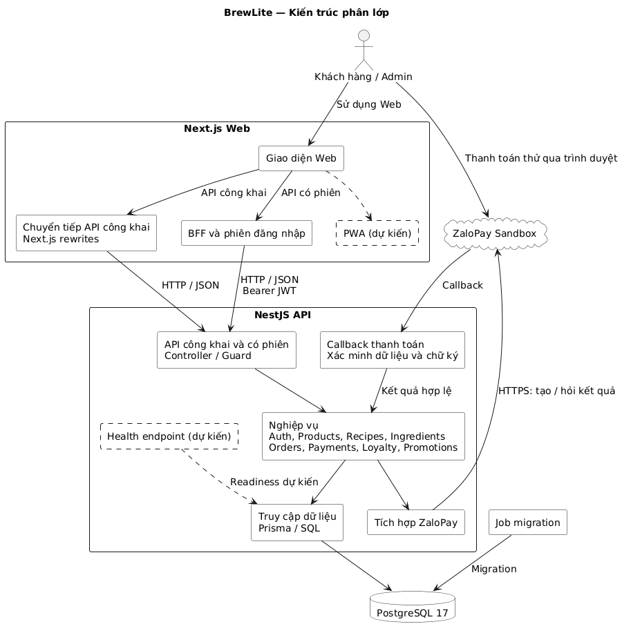

# Task 3.1 — Kiến trúc BrewLite

## 1. Kiến trúc phân lớp

BrewLite dùng Next.js cho giao diện, NestJS cho REST API và nghiệp vụ, PostgreSQL cho dữ liệu. Backend là **modular monolith**: các module chạy trong cùng một ứng dụng, dùng chung database để xử lý transaction đơn–kho–thanh toán–điểm.

[Nguồn PlantUML](../diagrams/architecture-layers.puml).

- API công khai như menu đi qua Next.js rewrites.
- API có phiên đi qua BFF `/api/session/...`. BFF đọc JWT từ cookie HttpOnly và gắn Bearer token khi gọi NestJS; backend kiểm tra phiên, quyền và dữ liệu.
- ZaloPay Sandbox gửi callback tới API. Backend xác minh chữ ký và dữ liệu gateway, không dùng JWT của khách cho callback.

## 2. Thành phần và nguồn kế thừa

| Thành phần | Trách nhiệm | Nguồn tham chiếu |
|---|---|---|
| Next.js Web/BFF | Menu, giỏ, tài khoản, checkout, lịch sử, Admin và chuyển tiếp API | `apps/web/app`, `components`, `lib/session-server.ts`, `server.mjs` |
| Auth | JWT, phiên, hồ sơ và phân quyền | `apps/api/src/auth` |
| Products, Recipes, Ingredients | Menu, công thức và nguyên liệu | `apps/api/src/products`, `recipes`, `ingredients` |
| Orders | Tạo đơn, giữ kho, lịch sử và trạng thái | `apps/api/src/orders` |
| Payments | Tạo thanh toán, callback/query và đối soát ZaloPay | `apps/api/src/payments` |
| Loyalty, Promotions | Tích điểm và mã BREW10 | `apps/api/src/loyalty`, `promotions` |
| PostgreSQL 17, Prisma 7 | Truy cập dữ liệu, schema, migration và seed | `apps/api/prisma`, `apps/api/prisma7.config.ts` |
| Job migration | Cập nhật database trước khi chạy API | `apps/api/Dockerfile`, `compose.yaml` |

Trong NestJS, Controller/Guard nhận request và kiểm tra quyền; Service xử lý nghiệp vụ; Prisma/SQL truy cập database.

## 3. Luồng nghiệp vụ chính

- **Menu:** Products đọc công thức/nguyên liệu và tính lượng còn có thể phục vụ. Khi đặt đơn, backend kiểm tra lại giá và kho.
- **Đặt đơn:** backend tính giá chính thức, tạo đơn PENDING và giữ nguyên liệu trong cùng transaction. Khóa/cập nhật có điều kiện và idempotency ngăn đặt vượt kho hoặc tạo trùng.
- **Thanh toán:** backend lấy số tiền từ đơn, tạo giao dịch Sandbox rồi xác minh callback/query. Thành công hợp lệ cập nhật đơn, giao dịch, kho và điểm trong cùng transaction; xử lý lặp không ghi thêm.
- **Kết quả chưa rõ:** tiếp tục kiểm tra, không tự kết luận thất bại khi mất mạng. Thành công sau khi đã trả kho chuyển sang đối soát. Tác vụ hết hạn/đối soát chạy trong API nên API cần hoạt động liên tục.

## 4. Cấu hình và vận hành

| Nội dung | Thiết kế |
|---|---|
| Phiên và quyền | JWT chứa `sub`/`sessionVersion`; quyền Admin đọc từ DB. Logout/đổi mật khẩu thu hồi phiên cũ. BFF kiểm tra Origin/CSRF; `server.mjs` xử lý IP kết nối cho giới hạn đăng nhập. |
| Migration | Lưu schema/migration trong Git; kiểm tra trên DB test trước khi áp dụng. Local có seed demo; production không mặc định chạy seed demo. |
| Cấu hình | `API_INTERNAL_URL` dùng lúc build rewrites và runtime BFF; `DATABASE_URL`, `PORT`, `APP_ORIGIN` cấp theo môi trường. |
| Secret | JWT, mật khẩu DB, khóa ZaloPay và `BFF_PROXY_SECRET` không đưa vào repo/log; BFF secret khớp Web/API. |
| Log và health | Container xuất stdout/stderr. Nguồn cũ probe Web qua `/`, API qua `/products`, DB qua `pg_isready`; health endpoint riêng cần bổ sung. |
| PWA | Cần bổ sung manifest, khả năng cài đặt và xử lý mất mạng theo SRS; responsive không tự chứng minh đạt PWA. |

## 5. Quyết định và trade-off

| Quyết định | Lợi ích | Hạn chế | ADR |
|---|---|---|---|
| Monorepo | Phối hợp Web/API/docs trong cùng PR | CI cần kiểm tra phần bị ảnh hưởng | [001](adr/001-monorepo.md) |
| Modular monolith | Ít dịch vụ, thuận lợi transaction | Thay module có thể phải phát hành lại API | [002](adr/002-modular-monolith.md) |
| PostgreSQL và Prisma | Dữ liệu nhất quán, migration có lịch sử | Cần SQL đặc thù cho khóa và kiểm tra migration | [003](adr/003-postgresql-prisma.md) |
| ZaloPay Sandbox | Kế thừa thanh toán thử hiện có | Phụ thuộc gateway; cần kiểm chứng Ví/Thẻ mô phỏng theo đề | [004](adr/004-zalopay-sandbox.md) |
| AWS EC2 và Compose | Tận dụng container hiện có | Nhóm tự vận hành, kiểm soát chi phí, backup và phục hồi | [005](adr/005-deployment-and-delivery.md) |

Chi tiết môi trường triển khai: [Task 3.2](../deployment.md). PWA, health riêng và hạ tầng production là phần cần hiện thực, chưa phải kết quả nghiệm thu.
