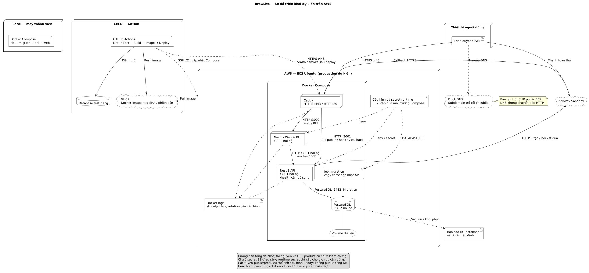

# Task 3.2 — Triển khai BrewLite

## 1. Nền tảng đã chọn

**AWS EC2 Ubuntu + Docker Compose + Caddy + Duck DNS + GitHub Actions + GHCR.** Đây là thiết kế đã chốt; chưa có tài nguyên và URL production được kiểm chứng. Sơ đồ phải cập nhật theo cấu hình thật trước nghiệm thu.

[Nguồn PlantUML](diagrams/deployment.puml) · [Kiến trúc](architecture/architecture.md).

## 2. Thành phần và kết nối

| Thành phần | Vai trò và kết nối |
|---|---|
| Thiết bị khách | Trình duyệt/PWA kết nối HTTPS cổng 443 tới Caddy |
| Duck DNS | Bản ghi tên miền trỏ tới IP public EC2; không chuyển tiếp HTTP |
| Caddy | Nhận HTTP 80/HTTPS 443, chuyển request tới Web/API nội bộ |
| Next.js Web/BFF | Cổng 3000 nội bộ; rewrites/BFF gọi NestJS cổng 3001 |
| NestJS API | Xử lý nghiệp vụ, kết nối PostgreSQL và gọi ZaloPay bằng HTTPS |
| PostgreSQL | Cổng 5432 nội bộ, volume bền vững; không public ra Internet |
| Job migration | Kết nối DB, hoàn tất thành công trước khi cập nhật API |
| GitHub Actions | Kiểm tra, build/push image, triển khai qua SSH cổng 22 và smoke test HTTPS |
| GHCR | Lưu image Web/API có tag commit SHA hoặc phiên bản; EC2 pull image |

Local kế thừa `compose.yaml` với thứ tự **DB healthy → migrate/seed thành công → API healthy → Web**. Web/API nguồn chỉ publish trên `127.0.0.1:3000/3001`. Database test CI tách khỏi production.

## 3. Định tuyến và cấu hình

| Luồng | Thiết kế | Phần chờ cấu hình thực tế |
|---|---|---|
| Frontend | HTTPS → Caddy → Web | Tên miền và Caddyfile |
| Menu/API công khai | Next.js rewrites → API; tuyến API public không xung đột trang Web | Prefix hoặc hostname API |
| API có phiên | `/api/session/...` → BFF → API; JWT từ cookie HttpOnly | Kiểm chứng cookie, Origin/CSRF và IP sau proxy |
| Callback | HTTPS → Caddy → `POST /payments/zalopay/callback`; backend xác minh chữ ký | URL callback public |
| Return | Trở về Web `/payment/result`, lấy kết quả từ API | Origin production |
| Health/smoke | CI gọi Web và API health qua HTTPS, kiểm tra mã HTTP/nội dung | Endpoint health và URL thật |

- **Secret:** CI giữ khóa SSH/quyền registry; EC2 cấp secret runtime qua môi trường Compose cho đúng dịch vụ. Không lưu secret trong repo/log. Chỉ cấp quyền triển khai cần thiết và hạn chế truy cập quản trị.
- **Web/API:** `API_INTERNAL_URL` cần đúng ở build và runtime; `BFF_PROXY_SECRET` khớp hai app, `APP_ORIGIN` khớp origin HTTPS.
- **Log:** Caddy/Web/API xuất stdout/stderr; Docker thu log và cần giới hạn dung lượng/rotation.
- **Health:** nguồn cũ dùng `/`, `/products`, `pg_isready`; bổ sung health endpoint riêng. API phải chạy liên tục cho tác vụ hết hạn/đối soát.
- **Dữ liệu:** giữ volume PostgreSQL; xác định nơi lưu backup và kiểm tra phục hồi. Không reset DB hoặc xóa volume để cập nhật.

## 4. Phát hành và rollback

1. PR chạy **Install → Lint → Unit Test → Build**; lỗi thì không merge.
2. Build image Web/API có tag SHA/phiên bản và push GHCR.
3. Actions dùng secret SSH tới EC2; pull đúng tag, sao lưu và chạy migration đã kiểm tra tương thích. Migration lỗi thì dừng; không tự chạy seed demo production.
4. Cập nhật dịch vụ bằng Compose; gọi health/smoke qua HTTPS. Kiểm tra cả API công khai, BFF và callback theo môi trường.
5. Khi lỗi, dừng phát hành và quay về image trước nếu DB tương thích. Rollback image không hoàn tác migration; dùng phương án phục hồi DB đã kiểm chứng khi cần.

## 5. Truy vết thành phần

| Thành phần | Code/cấu hình tham chiếu |
|---|---|
| Web/BFF | `apps/web/Dockerfile`, `next.config.ts`, `server.mjs`, `lib/session-server.ts` (tính từ `apps/web/`) |
| API | `apps/api/Dockerfile`, `apps/api/src/main.ts`, `apps/api/src/app.module.ts` |
| DB và migration | `compose.yaml`, `apps/api/prisma`, `apps/api/prisma7.config.ts` |
| ZaloPay | `apps/api/src/payments/zalopay.service.ts` |
| Caddy, DNS, registry, CI/CD, backup/log | Cấu hình cần bổ sung trên repo mới và môi trường triển khai |

Trước nghiệm thu: kiểm tra tài khoản/chi phí AWS, cập nhật tài nguyên và URL thật, cấu hình TLS/secret/backup/log, kiểm chứng health/smoke và ánh xạ tới code mới. PWA và yêu cầu Ví/Thẻ Sandbox được kiểm chứng khi hoàn thiện chức năng.
