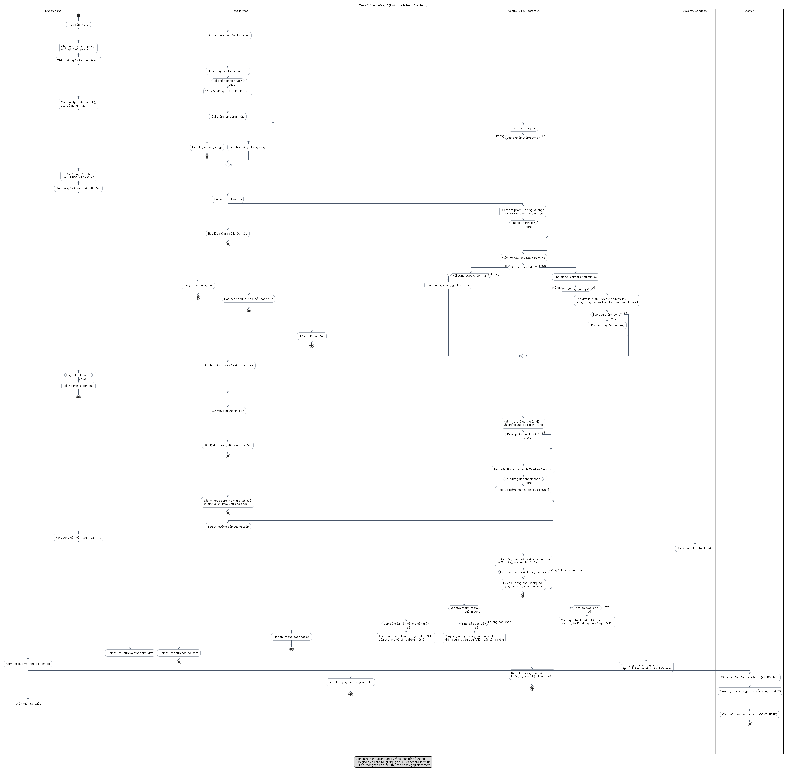
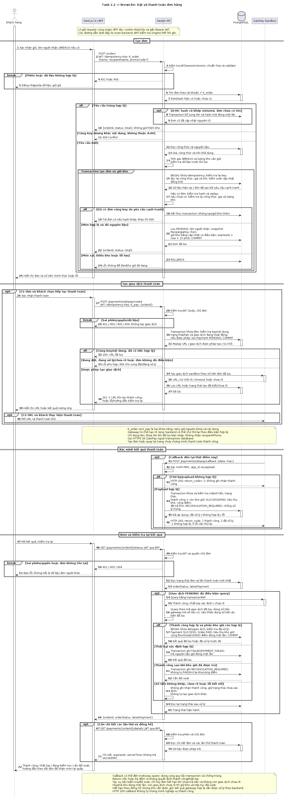
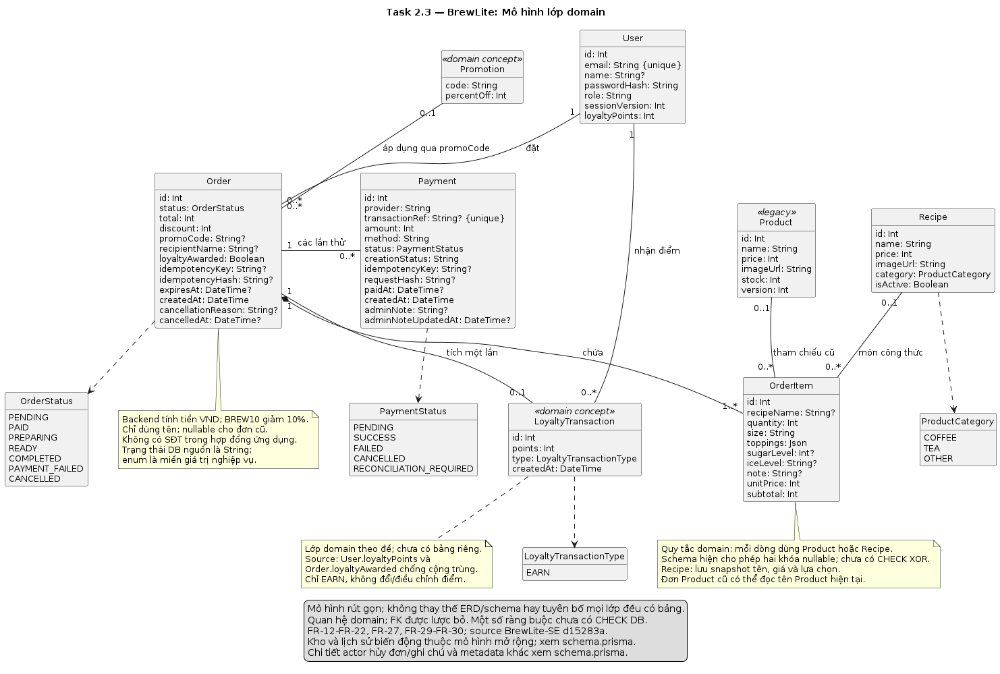

# Task 2 — Mô hình hóa BrewLite

Cập nhật: 10/11/2026. Bản nguồn chính thức dùng **PlantUML (`.puml`)**; PNG được kết xuất từ cùng nguồn. Các bản này chỉnh lại từ nội dung bốn ảnh tham khảo do nhóm cung cấp, theo SRS đã chốt: chỉ tên người nhận, ZaloPay Sandbox và giữ chức năng Admin nguồn.

## 1. Danh sách sơ đồ

| Task | Nguồn PlantUML | Bản PNG |
| --- | --- | --- |
| 2.1 Activity | [activity-checkout.puml](activity-checkout.puml) | [Xem ảnh](activity-checkout.png) |
| 2.2 Sequence checkout | [sequence-checkout.puml](sequence-checkout.puml) | [Xem ảnh](sequence-checkout.png) |
| 2.3 Class domain | [class-domain.puml](class-domain.puml) | [Xem ảnh](class-domain.png) |

Sequence checkout là một luồng liên tục từ tạo đơn đến xác minh kết quả. Ảnh PNG không thay thế nguồn PUML. Hai bản tách phần vẫn được giữ để thuận tiện xem riêng.

## 2. Activity



Có điểm bắt đầu/kết thúc, swimlane Khách hàng, Next.js Web, NestJS API & PostgreSQL, ZaloPay Sandbox và Admin; các decision/merge phân biệt chưa đăng nhập, dữ liệu sai, yêu cầu trùng, thiếu kho, lỗi lưu, thanh toán thành công/thất bại/chưa rõ, kết quả không hợp lệ, hết hạn và cần đối soát. Kết quả sai chữ ký, mã hoặc số tiền không được coi là thất bại xác định. Điểm kết thúc ở nhánh lỗi là kết thúc lượt thao tác đang xét; khách vẫn có thể sửa và bắt đầu lại.

Đặt đơn và giữ nguyên liệu là một transaction. Thành công thanh toán mới tiêu thụ kho và cộng điểm. Callback không phụ thuộc việc khách quay lại trang; kết quả vẫn được backend xử lý khi khách rời trang.

## 3. Sequence



Năm lifeline theo đề: Customer → Next.js UI/BFF → NestJS API → PostgreSQL → ZaloPay Sandbox. Route ghi trên thông điệp là route NestJS; các request riêng tư từ UI đi qua BFF. Không lưu JWT trong state trình duyệt.

- `POST /orders`: chỉ `recipientName`, `items`, `promoCode` tùy chọn; response `{orderId,status,total}`. Frontend gửi K_order; backend nguồn cho phép thiếu header nên client phải giữ key trước retry.
- A-06: cùng tài khoản/key, hash cũ khớp món/khuyến mãi, đơn chưa lưu tên thì bổ sung tên/hash nguyên tử đúng một lần. Source tính giá trước transaction, rồi trong transaction kiểm tra lại key và thông tin công thức/giá trước khi lưu và giữ kho.
- `POST /payments/zalopay/create`: body `{orderId}`; K_pay bắt buộc, độc lập với K_order. Replay URL trả 200, tạo thành công trả 201; không tự tạo thêm khi chưa rõ kết quả.
- Callback dùng MAC/app_id/payload và đối chiếu giao dịch/số tiền. HTTP 200 có mã kết quả nghiệp vụ riêng; callback/query dùng cùng cơ chế xử lý nguyên tử và chống trùng. Query theo mã giao dịch; nếu gateway không trả số tiền, source dùng số tiền dự kiến đã lưu, nên không thể khẳng định luôn đối chiếu số tiền do gateway trả.
- `/status` trả trạng thái đơn/lần thử mới nhất. `/details` cung cấp chi tiết các lần thử, giờ máy chủ và hạn đơn. Không gộp hai response thành hợp đồng không có ở source.
- Thất bại xác định trả kho đúng một lần. Thành công sau khi đã trả kho chuyển đối soát; không tự trừ lại kho/cộng điểm. Kho còn được giữ sau mốc đồng hồ không tự bị coi là vô hiệu khi gateway xác nhận hợp lệ.

## 4. Class domain



Có đủ User, Product, Order, OrderItem, Payment, Promotion và LoyaltyTransaction theo đề; bổ sung Recipe để phản ánh menu thực tế. Theo quy tắc domain, mỗi OrderItem tham chiếu một Product legacy hoặc Recipe. Prisma hiện cho phép cả hai khóa nullable; migration chưa có CHECK bảo đảm XOR. Multiplicity diễn tả quy tắc domain, chưa chứng minh database thực thi; FK được biểu diễn bằng quan hệ thay vì lặp lại thuộc tính.

Promotion và LoyaltyTransaction mang stereotype `domain concept`: đề yêu cầu lớp domain, source chưa có hai bảng tương ứng. Không tuyên bố chúng đã được triển khai. Source dùng BREW10, Order.promoCode/discount và User.loyaltyPoints/Order.loyaltyAwarded. Chỉ có nghiệp vụ tích điểm EARN trong phạm vi; không có đổi điểm/điều chỉnh điểm.

Đây là mô hình rút gọn của luồng trọng tâm; schema còn chứa nguyên liệu, định lượng, giữ kho và lịch sử. Hủy đơn và ghi chú Admin được biểu diễn bằng thuộc tính Order/Payment; mô hình không thay thế toàn bộ ERD hoặc SRS Admin.

## 5. Đối chiếu và truy vết

Nguồn yêu cầu: [SRS](../requirements/srs.md), [use-case checkout](../requirements/use-case-checkout.md). Nguồn code tham chiếu: BrewLite-SE commit `d15283a9d8b307c0af42642279ae6158c92e2864`; các đường dẫn sau tính từ gốc repo cũ.

| Phần | FR/NFR | Bằng chứng source |
| --- | --- | --- |
| Tạo đơn, chống trùng, giữ kho | FR-12–FR-15; NFR-04 | `apps/api/src/orders/orders.controller.ts`, `dto/create-order.dto.ts`, `orders.service.ts`, `orders.prisma-adapter.ts` (ba đường dẫn cuối thuộc `apps/api/src/orders/`) |
| Tạo giao dịch/callback/query | FR-16–FR-18; NFR-03–NFR-04 | `apps/api/src/payments/payments.controller.ts`, `payments.service.ts`, `payments.prisma-adapter.ts`, `zalopay-reconciliation.ts` (ba đường dẫn cuối thuộc `apps/api/src/payments/`) |
| Hạn, giữ/trả kho, điểm | FR-19–FR-21 | `apps/api/src/orders/orders.expiration.service.ts`, `apps/api/src/payments/payments.prisma-adapter.ts` |
| Chi tiết và đồng hồ | FR-18–FR-19, FR-22 | `apps/api/src/payments/payment-details.service.ts`, `apps/web/lib/session-server.ts` |
| Lớp và trạng thái | FR-12–FR-22, FR-27, FR-29–FR-30 | `apps/api/prisma/schema.prisma`, `apps/api/src/orders/order-state.ts` |

Bảng này hỗ trợ review sơ đồ, chưa thay thế ma trận truy vết toàn dự án hoặc chứng minh test đã đạt. Repo mới vẫn cần tích hợp code, chạy kiểm thử và có xác nhận nghiệm thu.

## 6. Kết xuất

Dùng PlantUML có Graphviz và font hỗ trợ tiếng Việt. Ví dụ khi máy có lệnh `plantuml`:

```bash
plantuml -checkonly docs/diagrams/*.puml
plantuml -tpng docs/diagrams/activity-checkout.puml docs/diagrams/sequence-checkout.puml docs/diagrams/class-domain.puml
```

Nếu dùng JAR, thay `plantuml` bằng `java -jar /duong-dan/plantuml.jar`. Kiểm tra cú pháp và xem lại ảnh sau mỗi lần sửa nguồn.
