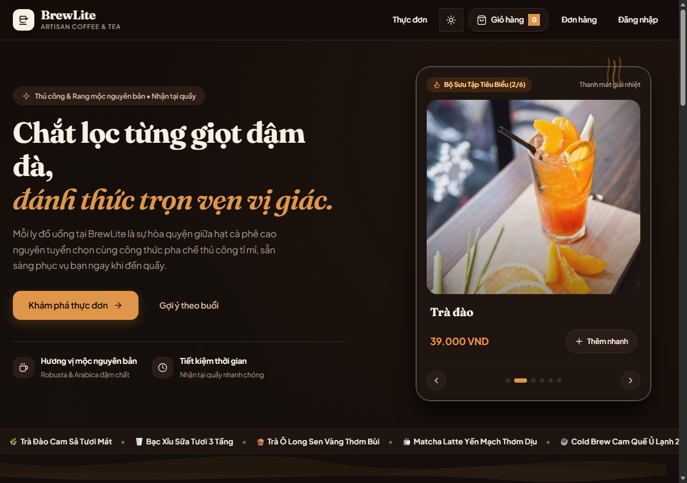
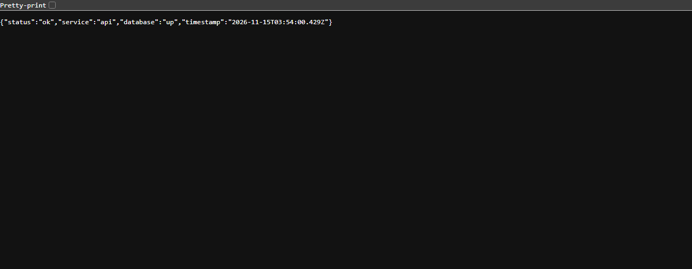

# Minh chứng Task 5.3.1 & 5.4.1 — CD Pipeline & Triển khai AWS EC2 (Caddy + DuckDNS + Docker Compose)

Ngày cập nhật: **15/11/2026** (sau khi hợp nhất quy trình backup/migration/rollback của Issue `#38` từ `main` tại `2ea8636`).

## Mục tiêu & Đối chiếu phản hồi review PR #66

1. **Docker build context trong `.github/workflows/cd.yml`**: `brewlite-api-migrate` và `brewlite-api` dùng `context: ./apps/api`, `file: ./apps/api/Dockerfile`; `brewlite-web` dùng `context: ./apps/web`, `file: ./apps/web/Dockerfile`.
2. **Phối hợp quy trình Issue `#38` (`scripts/db/*.mjs`)**:
   - `cd.yml` thêm job `db-operations-gate` kiểm tra cú pháp `deploy/scripts/*.sh`, `scripts/db/*.mjs`, `compose config`, build target `migration` từ `./apps/api`, và chạy `npm run test:db-operations` (`BREWLITE_DB_OPERATIONS_TESTS=1`).
   - `cd.yml` chuyển trọn gói `compose.prod.yaml`, `deploy/caddy/Caddyfile`, `deploy/scripts/`, `scripts/db/`, và `apps/api/prisma/migrations/` sang EC2 (`/opt/brewlite`).
   - `deploy/scripts/deploy.sh` khóa tiến trình bằng `flock`, không dùng quy trình `pg_dump | gzip` riêng, không tự xóa backup, và gọi thẳng `node scripts/db/migrate.mjs` (`--output-dir /srv/brewlite/backups`, `--confirm-database "$DB_NAME"`, `--schema-reviewed`, không seed trong CD), sau đó khởi động `api`, `web`, `caddy` bằng `--no-deps`.
   - `deploy/scripts/mark-release.sh` chỉ chuyển `.pending-release` -> `.current-release` (và lưu `.previous-release`) **sau khi** bước kiểm tra HTTPS (`scripts/check-compose.mjs`) và đóng port `5432` hoàn tất.
   - `deploy/scripts/rollback.sh` gọi thẳng `node scripts/db/rollback-app.mjs --schema-compatible` và kiểm tra `caddy` (`--no-deps`).
3. **Rà soát khóa ZaloPay & secrets**: đã loại bỏ các giá trị khóa ZaloPay khỏi `compose.prod.yaml` và `.env.prod.example`; mọi secret (`DB_PASSWORD`, `JWT_SECRET`, `BFF_PROXY_SECRET`, `CADDY_PROXY_SECRET`, `ZALOPAY_APP_ID`, `ZALOPAY_KEY1`, `ZALOPAY_KEY2`) chỉ cấu hình tại `/opt/brewlite/.env.prod` trên EC2.
4. **Kiểm thử triển khai thực tế trên AWS EC2 (`3.107.1.135`) & xác minh HTTPS/API/ZaloPay/PostgreSQL**: chi tiết ở các mục dưới.

## Kiểm tra local (trên checkout đã merge `main`)

| Hạng mục | Lệnh / Phạm vi | Kết quả |
|---|---|---|
| Lint & Unit Test Web | `npm --prefix apps/web run lint` & `npm --prefix apps/web test -- --maxWorkers=1` | ESLint PASS; **18/18 file, 219/219 test PASS** (gồm 3 test `server-proxy-headers.test.ts`) |
| Lint & Unit Test API | `npm --prefix apps/api run lint` & `npm --prefix apps/api test -- --maxWorkers=1` | `oxlint`: 0 warnings/0 errors; **24/24 unit suite, 240 PASS** (5 integration suite skip do không bật DB local) |
| Build Docker images (`./apps/api`, `./apps/web`) | `docker build --target migration ./apps/api`, `--target runtime ./apps/api`, `--target runtime ./apps/web` | Build thành công cả 3 image `linux/amd64` từ context chuẩn của từng app |
| Validate `compose.prod.yaml` & `Caddyfile` | `docker compose ... -f compose.prod.yaml config --quiet` & `caddy:2-alpine caddy validate` | PASS (`db`, `api`, `web` không mở host port; Caddyfile `Valid configuration`) |
| Shell syntax & LF | `bash -n deploy/scripts/*.sh` (trong `node:24-bookworm-slim`) & kiểm tra byte `\r` | PASS (`LF_OK`, không lỗi cú pháp) |
| DB operations suite (`#38`) trên Windows | `BREWLITE_DB_OPERATIONS_TESTS=1 npm run test:db-operations` | 8/10 PASS trên Windows NTFS; 2 case fail do Windows không giữ POSIX mode `0o600` (`438 !== 384`, chạy chuẩn trên `ubuntu-latest` trong `db-operations-gate`) |

## Kiểm chứng thực tế trên AWS EC2 (`3.107.1.135` / `https://brewlite-a2.duckdns.org`)

- **Hạ tầng EC2**: Ubuntu `x86_64` (`linux/amd64`), Docker `29.9.3`, Docker Compose `v5.7.1`, Node.js `v24.22.3`, 2 GB swap (`/swapfile`), Security Group chỉ mở `22`, `80`, `443`, thư mục backup `/srv/brewlite/backups` quyền `0700` thuộc `ubuntu`.
- **Triển khai & tích hợp `#38` trên EC2 (`SKIP_PULL=true` với 3 image `deb81bb5bf8cb8da76b9e1dd79325226b4e18903` build từ `./apps/api` và `./apps/web`)**:
  - `deploy.sh --schema-reviewed`: kiểm tra cô lập port `db` (`{"5432/tcp":null}`), chạy `scripts/db/migrate.mjs` (16 migration, `seeded: false`), tạo backup validated + checksum SHA-256 tại `/srv/brewlite/backups/brewlite_prod-20261115T033530456Z-f8bea371.dump`, sau đó chạy seed thủ công 1 lần cho DB mới và chạy lại lượt `deploy.sh` thứ 2 (`brewlite_prod-20261115T033952971Z-d1f14051.dump`).
  - `mark-release.sh` & `rollback.sh --schema-compatible`: xác nhận ghi nhận `.current-release` và chạy `scripts/db/rollback-app.mjs` thành công (`{"rolledBack":true,"health":"ok","databaseRestored":false,"migrationsRun":false}`).
- **Kiểm tra từ Internet qua HTTPS & cô lập PostgreSQL**:
  - `node scripts/check-compose.mjs --api-url=https://brewlite-a2.duckdns.org --web-url=https://brewlite-a2.duckdns.org`: **7/7 PASS** (`API /health` `database=up`, `/products` 10 items, `Web /api/health` `ok`, `Web /api/health?deep=1` `upstream=up`, `/` HTTP 200 `lang=vi`, `/products` rewrite 10 items, `/api/session/login` BFF HTTP 401).
  - Redirect & TLS: `http://brewlite-a2.duckdns.org/health` trả `308` -> `https://brewlite-a2.duckdns.org/health`; chứng chỉ TLS hợp lệ từ **Let's Encrypt** (`authorized: true`, hạn `Feb 13 02:37:23 2027 GMT`), kèm header bảo mật `X-Content-Type-Options: nosniff`, `Referrer-Policy: strict-origin-when-cross-origin`, `X-Frame-Options: SAMEORIGIN`.
  - ZaloPay callback HTTPS: `POST https://brewlite-a2.duckdns.org/payments/zalopay/callback` tới thẳng NestJS API trả `HTTP 200 {"return_code":-1,"return_message":"mac not equal"}` (đã qua Caddy HTTPS và nhận body callback).
  - Cô lập PostgreSQL: kết nối TCP ngoài Internet tới `3.107.1.135:5432` thất bại (`CLOSED_TIMEOUT`), `docker compose ps` chỉ có `brewlite-caddy-1` mở `80/443`, `brewlite-db-1` chỉ có `5432/tcp` nội bộ.

### Ảnh chụp minh chứng từ `https://brewlite-a2.duckdns.org`

## Phạm vi cần hoàn tất khi Leader review & merge PR #66

- Do thành viên không có quyền `Admin` vào **Repository Settings** và workflow `CD` trên `push` vào `main` chỉ chạy sau khi PR #66 được merge vào `main`, lượt chạy **GitHub Actions `CD` -> push GHCR -> deploy từ runner GitHub** chưa thể kích hoạt trước khi merge.
- Khi leader cấu hình 4 secrets (`EC2_HOST=3.107.1.135`, `EC2_USER=ubuntu`, `EC2_SSH_KEY`, `APP_DOMAIN=brewlite-a2.duckdns.org`) trên Environment `production` (không bật required reviewers) và merge PR #66 vào `main`, workflow `CD` sẽ tự chạy toàn bộ `quality-gate` + `db-operations-gate` -> `build-and-push` GHCR -> `deploy` sang EC2 -> `check-compose.mjs` HTTPS & kiểm tra port `5432`.
