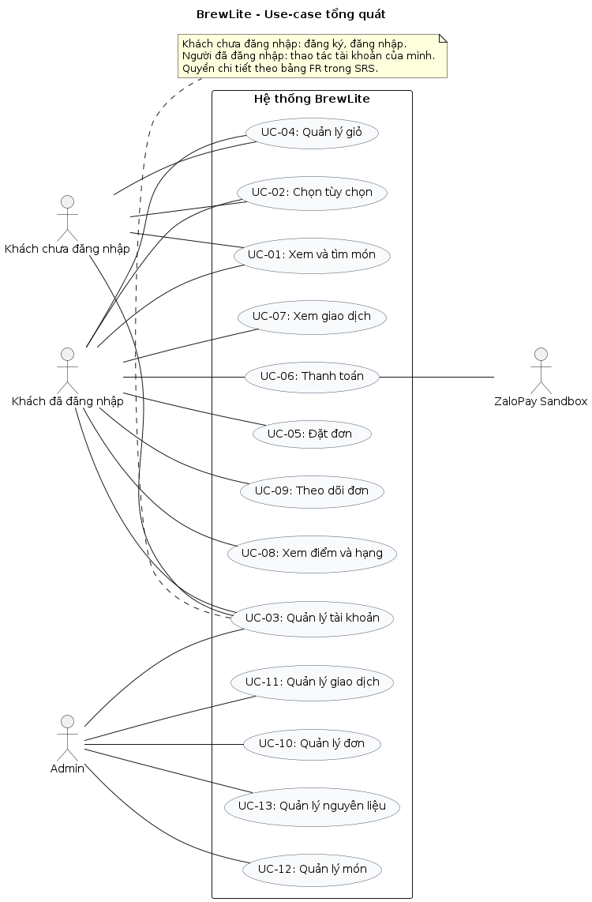

# Task 1.2 Yêu cầu chức năng và phi chức năng

## 1. Mục đích và phạm vi

Tài liệu này xác định website BrewLite cần làm gì và điều kiện để kiểm tra các chức năng đó. Website dùng được trên trình duyệt máy tính và điện thoại, phục vụ một cửa hàng đồ uống nhận món tại quầy.

Khách hàng xem menu, chọn món và tùy chọn, quản lý giỏ, đặt đơn, thanh toán qua ZaloPay Sandbox và theo dõi đơn. Admin quản lý món, công thức, nguyên liệu, cập nhật tiến độ đơn và xem giao dịch cần đối soát. Thanh toán chỉ dùng môi trường thử nghiệm, không thu tiền thật.

Mỗi yêu cầu có mức ưu tiên và tiêu chí chấp nhận để nhóm thực hiện và kiểm tra. Phạm vi chi tiết được trình bày trong [Bối cảnh và phạm vi](context-and-scope.md).

Ưu tiên theo MoSCoW:

- Must: bắt buộc để đáp ứng đề và hoàn thành luồng chính.

- Should: thuộc phạm vi đã thống nhất, cần hoàn thiện; nếu hoãn phải được nhóm chấp thuận.

- Could: có thể thêm khi còn thời gian; bản này chưa cam kết chức năng ở mức này.

- Won’t: không làm trong Ass2, được liệt kê tại mục 6.

## 2. Tác nhân và quyền sử dụng

| Tác nhân | Chức năng sử dụng |
| --- | --- |
| Khách chưa đăng nhập | Xem/tìm món, lọc danh mục, chọn tùy chọn và dùng giỏ hàng |
| Khách đã đăng nhập (CUSTOMER) | Các quyền trên; quản lý hồ sơ, đặt/thanh toán đơn, xem đơn, giao dịch và điểm của mình |
| Quản lý (ADMIN) | Quản lý món, công thức, nguyên liệu; xem/lọc đơn, cập nhật tiến độ và xem giao dịch cần đối soát |
| ZaloPay Sandbox | Dịch vụ bên ngoài tiếp nhận yêu cầu thanh toán, gửi thông báo và cung cấp kết quả giao dịch |

UC-03 trong sơ đồ gom các thao tác tài khoản: khách chưa đăng nhập chỉ đăng ký/đăng nhập; người đã đăng nhập mới được đăng xuất, đổi mật khẩu và sửa hồ sơ của mình.

Nhân viên quầy là bên liên quan khi pha chế và giao món, chưa có tài khoản hoặc role STAFF riêng. Thao tác trên website do Admin thực hiện.

## 3. Yêu cầu chức năng

Mỗi yêu cầu có mã để đối chiếu với sơ đồ, code và kiểm thử. Tiêu chí chấp nhận mô tả kết quả cần kiểm tra, chưa phải kết quả đã đạt.

### 3.1. Menu và tùy chọn món

| Mã | Yêu cầu | Ưu tiên | Tiêu chí chấp nhận |
| --- | --- | --- | --- |
| FR-01 | Xem menu | Must | • Khách chưa đăng nhập vẫn xem được tên, ảnh, giá size M và tình trạng còn hàng; menu chỉ hiển thị món đang bán. • Khi đang tải, danh sách trống hoặc tải lỗi, website hiển thị trạng thái tương ứng; khi lỗi có nút thử lại. |
| FR-02 | Tìm và lọc món | Should | • Nhập “ca phe” tìm được “Cà phê”; tìm kiếm không phân biệt hoa/thường, dấu và đ/d, bỏ khoảng trắng ở đầu/cuối. • Có thể kết hợp tìm kiếm với lọc danh mục, chọn “Tất cả” để bỏ lọc và xóa từ khóa. • Nếu không có món phù hợp, website thông báo không tìm thấy. |
| FR-03 | Xem chi tiết và chọn size/topping | Must | • Khách xem chi tiết và chọn size S/M/L, topping, số ly. Ban đầu chọn size M nếu khả dụng; nếu không, ưu tiên L rồi S còn hàng và có giá hợp lệ. Ban đầu không topping, số lượng 1 ly. • Khi thay đổi lựa chọn, giá cập nhật theo mục 7. Giao diện nhận 1–99 ly và không cho chọn vượt số còn hàng theo size; nếu không còn size nào khả dụng thì không cho thêm vào giỏ. • Khi đặt đơn, máy chủ kiểm tra lại nguyên liệu, số ly nguyên dương và từ chối lựa chọn có giá âm. |
| FR-04 | Chọn đường/đá và ghi chú | Should | • Khách chọn đường 0%, 50%, 100%; đá không đá (NONE), ít đá (LESS), bình thường (NORMAL); ghi chú tối đa 200 ký tự và được bỏ khoảng trắng đầu/cuối khi lưu. • Máy chủ từ chối mức đường/đá không hợp lệ hoặc ghi chú quá dài. • Sau khi tải lại, lựa chọn vẫn có trong giỏ và hiển thị đúng ở checkout, lịch sử và chi tiết đơn Admin. Đơn cũ thiếu dữ liệu hiển thị chưa ghi nhận, không tự gán khẩu vị. |

### 3.2. Tài khoản và giỏ hàng

| Mã | Yêu cầu | Ưu tiên | Tiêu chí chấp nhận |
| --- | --- | --- | --- |
| FR-05 | Đăng ký | Must | • Email phải đúng định dạng và chưa được đăng ký. Mật khẩu có ít nhất 8 ký tự, tối đa 72 byte UTF-8; hai lần nhập mật khẩu phải khớp trước khi gửi. • Thông tin không hợp lệ hoặc email đã dùng phải được báo lỗi. Tài khoản tạo mới là CUSTOMER, có 0 điểm; khách không tự đăng ký quyền Admin. |
| FR-06 | Đăng nhập và hiện/ẩn mật khẩu | Must | • Email và mật khẩu đúng thì đăng nhập thành công; thông tin sai được báo lỗi. Form đăng nhập chỉ yêu cầu nhập mật khẩu một lần. • Mật khẩu được che sẵn trên các form; nút hiện/ẩn không làm mất nội dung hoặc tự gửi form. |
| FR-07 | Đăng xuất và hết phiên | Must | • Khi đăng xuất, xóa thông tin đăng nhập, giỏ và dữ liệu lượt mua trên thiết bị; các đơn đã lưu vẫn được giữ. • Khi phiên hết hạn, yêu cầu khách đăng nhập lại, giữ giỏ và không hiển thị dữ liệu riêng tư của phiên cũ. |
| FR-08 | Đổi mật khẩu | Should | • Khách đã đăng nhập phải nhập đúng mật khẩu hiện tại. Mật khẩu mới có ít nhất 8 ký tự, tối đa 72 byte UTF-8 và trùng với phần xác nhận; dữ liệu sai hoặc cập nhật lỗi thì mật khẩu không đổi. • Đổi thành công: mật khẩu mới đăng nhập được, mật khẩu cũ bị từ chối; mọi phiên và JWT cũ bị thu hồi, khách phải đăng nhập lại. • Hai yêu cầu đổi mật khẩu đồng thời không được dùng mật khẩu cũ để ghi đè kết quả của nhau. |
| FR-09 | Xem và sửa hồ sơ | Should | • Khách xem email và chỉ sửa tên hồ sơ của mình. Tên sau khi bỏ khoảng trắng đầu/cuối dài 1–100 ký tự; dữ liệu sai bị báo lỗi và không được lưu. • Lưu tên thành công rồi mở lại vẫn thấy tên đã lưu. Không thu thập số điện thoại; không cho sửa email, quyền hoặc hồ sơ người khác. |
| FR-10 | Quản lý giỏ hàng | Must | • Khách thêm món, thay đổi số ly hoặc xóa từng dòng; tổng tiền được tính lại. Tải lại trang vẫn còn giỏ. • Cùng món và cùng mọi tùy chọn, ghi chú thì gộp số ly; khác một lựa chọn hoặc ghi chú thì tách dòng. Giỏ trống không được tạo đơn. |
| FR-11 | Xác nhận xóa toàn bộ giỏ | Should | • Khi chọn xóa toàn bộ giỏ, website mở hộp xác nhận. Đồng ý mới xóa; hủy hoặc đóng hộp thì giữ giỏ. • Có thể thao tác hộp xác nhận bằng bàn phím. |

### 3.3. Đặt đơn, thanh toán và điểm thưởng

| Mã | Yêu cầu | Ưu tiên | Tiêu chí chấp nhận |
| --- | --- | --- | --- |
| FR-12 | Nhập thông tin người nhận | Must | • Khi tạo đơn, khách nhập tên người nhận dài 2–100 ký tự sau khi bỏ khoảng trắng đầu/cuối; website và máy chủ từ chối tên không hợp lệ. Không thu thập số điện thoại. • Khôi phục tên từ bản nháp hoặc lượt mua đang lưu của cùng tài khoản nếu có; không tự lấy từ hồ sơ. Nếu chưa có tên thì để trống cho khách nhập. • Khi bản nháp đã có tên, khóa trường tên để gửi lại cùng yêu cầu; bản nháp cũ thiếu tên được bổ sung. Sau khi tạo đơn, dùng tên lưu riêng trong đơn; sửa hồ sơ không đổi tên ở đơn cũ. |
| FR-13 | Áp dụng khuyến mãi | Must | • Mỗi đơn dùng tối đa một mã. BREW10 giảm 10% tổng tiền món và tùy chọn; tiền giảm làm tròn xuống đến đồng. • Mã không phân biệt hoa/thường và được bỏ khoảng trắng đầu/cuối. Không nhập mã thì không giảm; mã khác BREW10 bị báo lỗi. • Máy chủ tính lại và lưu mã cùng tiền giảm vào đơn. |
| FR-14 | Tạo đơn và giữ kho | Must | • Chỉ khách đã đăng nhập mới xác nhận tạo đơn. Máy chủ kiểm tra món, tùy chọn, số ly, mã giảm và nguyên liệu còn dùng được. • Nếu hợp lệ, tạo đơn chờ thanh toán, lưu giá và lựa chọn, đồng thời giữ nguyên liệu với hạn ban đầu 15 phút. • Nếu thao tác tạo đơn hoặc giữ kho lỗi, không để lại đơn hay phần kho giữ dở dang. |
| FR-15 | Chống tạo đơn trùng | Must | • Cùng tài khoản gửi lại cùng Idempotency-Key và nội dung đã chuẩn hóa thì nhận đơn cũ; không tạo đơn hoặc giữ thêm kho. Nội dung gồm món, lựa chọn, mã khuyến mãi và tên người nhận. • Cùng key nhưng nội dung khác bị từ chối. Ngoại lệ: đơn cũ cùng tài khoản/key, chưa có tên và có mã kiểm tra cũ khớp món/khuyến mãi được bổ sung tên hợp lệ đúng một lần. • Khi áp dụng ngoại lệ, máy chủ cập nhật tên và mã kiểm tra trong cùng transaction rồi trả đơn cũ; lần gửi sau so sánh đầy đủ nội dung. |
| FR-16 | Thanh toán ZaloPay Sandbox | Must | • Chủ đơn đã đăng nhập chỉ thanh toán khi đơn đủ điều kiện. Máy chủ lấy số tiền từ đơn đã lưu, tạo giao dịch ZaloPay Sandbox và trả đường dẫn thanh toán. • Chỉ khi máy chủ xác minh thành công và phần nguyên liệu giữ còn hợp lệ, đơn mới chuyển sang PAID, nguyên liệu được tiêu thụ và điểm được cộng. Quay lại website không tự chứng minh thanh toán thành công. • Trường hợp thành công sau khi đã trả kho được xử lý theo FR-20. |
| FR-17 | Xử lý kết quả và giao dịch trùng | Must | • Bấm thanh toán nhiều lần hoặc gửi đồng thời không tạo nhiều giao dịch đang hoạt động cho cùng đơn; callback lặp không trừ kho hoặc cộng điểm thêm. • Khi gateway từ chối rõ ràng, website thông báo lỗi; chỉ thử lại nếu máy chủ cho phép. Khi kết quả chưa rõ, hệ thống tiếp tục kiểm tra và không tự báo thất bại hoặc tạo giao dịch khác. |
| FR-18 | Xem kết quả và chi tiết thanh toán | Must | • Chủ đơn xem được kết quả, số tiền, phương thức, thời gian và mã giao dịch nếu có; phân biệt được các lần thử thanh toán. • Khi kết quả chưa rõ, hiển thị “Đang kiểm tra kết quả” và cho kiểm tra lại. Tải lại trang lấy kết quả từ máy chủ, không tự tạo giao dịch. • Không trả khóa bí mật, chữ ký hoặc dữ liệu thanh toán nhạy cảm cho người dùng. |
| FR-19 | Hiển thị thời gian còn lại | Should | • Đồng hồ lấy hạn đơn từ máy chủ; tải lại trang không bắt đầu đếm lại và đồng hồ dừng ở 0. • Khi hết giờ, website lấy lại trạng thái máy chủ; không tự kết luận thất bại, trả kho hoặc tạo giao dịch khác. |
| FR-20 | Xử lý đơn hết hạn | Must | • Khi đơn chưa thanh toán hết hạn và không còn giao dịch chưa rõ, hệ thống hủy đơn và trả kho đang giữ đúng một lần. • Nếu còn giao dịch chưa rõ, tiếp tục giữ nguyên liệu và kiểm tra với ZaloPay. • Nếu phát hiện giao dịch thành công sau khi kho đã được trả, đưa giao dịch vào diện cần đối soát; không tự chuyển đơn thành đã thanh toán bình thường. |
| FR-21 | Tích điểm và xem hạng thành viên | Must | • Mỗi 10.000đ thực trả sau giảm giá được 1 điểm, bỏ phần lẻ; ví dụ 49.500đ được 4 điểm. Chỉ cộng khi thanh toán được xác nhận thành công và không cộng lặp cho cùng đơn. • Khách xem tổng điểm và điểm dự kiến. Hạng Đồng: 0–99 điểm; Bạc: 100–299; Vàng: từ 300. Hạng Đồng/Bạc hiển thị hạng tiếp theo và số điểm cần thêm; hạng Vàng không hiển thị hạng tiếp theo. • Tải điểm lỗi thì báo lỗi, cho thử lại và không tự hiển thị 0 điểm hoặc hạng. Hạng chỉ để hiển thị, không kèm ưu đãi hay đổi điểm. |

### 3.4. Theo dõi và quản lý cửa hàng

| Mã | Yêu cầu | Ưu tiên | Tiêu chí chấp nhận |
| --- | --- | --- | --- |
| FR-22 | Xem lịch sử và chi tiết đơn | Must | • Khách chỉ xem đơn của mình, gồm mã, thời gian, tổng tiền, trạng thái, người nhận và chi tiết món, size, topping, đường/đá, ghi chú. • Đơn Recipe lưu riêng tên món, lựa chọn và giá; sửa menu không làm đổi thông tin đã lưu. Đơn Product cũ chưa có snapshot tên có thể dùng tên Product hiện tại, nhưng giá lấy từ dòng đơn. • Thông tin người nhận hoặc khẩu vị chưa lưu ở đơn cũ phải hiển thị là chưa ghi nhận. |
| FR-23 | Tự cập nhật tiến độ | Should | • Khi khách mở chi tiết đơn, website tự lấy tiến độ mới. Khi đơn sẵn sàng, website báo khách nhận tại quầy bằng mã đơn. • Ngừng tự cập nhật khi đơn hoàn tất, bị hủy, thanh toán thất bại hoặc khách rời trang; khách có thể tải lại để lấy trạng thái mới. • Mất mạng thì giữ trạng thái cập nhật thành công gần nhất, báo lỗi và cho thử lại. |
| FR-24 | Admin xem và lọc đơn | Must | • Chỉ Admin xem được danh sách và chi tiết đơn quản trị. Có thể lọc theo ngày tạo và trạng thái, bỏ lọc để xem lại toàn bộ; ngày bắt đầu sau ngày kết thúc bị báo lỗi. • Bộ lọc áp dụng trước phân trang; tổng số đơn và số trang phải khớp. Khi đổi bộ lọc, trở về trang đầu. • Dùng giờ Việt Nam UTC+07:00: từ 00:00 ngày bắt đầu đến trước 00:00 của ngày sau ngày kết thúc; kiểm tra cả hai ranh giới. |
| FR-25 | Admin cập nhật tiến độ | Must | • Chỉ Admin được chuyển tiến độ theo thứ tự PAID → PREPARING → READY → COMPLETED; máy chủ từ chối chuyển sai thứ tự. • Hai người cập nhật đồng thời không được ghi đè trạng thái mới bằng dữ liệu cũ. Admin không được tự đánh dấu đơn đã thanh toán. |
| FR-26 | Admin xem giao dịch cần đối soát | Should | • Chỉ Admin được xem và lọc giao dịch RECONCILIATION_REQUIRED, gồm đơn liên quan, số tiền, mã và trạng thái giao dịch nếu có. • Không có chức năng tự đánh dấu giao dịch thành công hoặc hoàn tiền tự động. |
| FR-27 | Quản lý món, công thức và danh mục | Must | • Admin xem, tạo và sửa tên món, giá, ảnh, thành phần, định lượng, danh mục và trạng thái bán; máy chủ từ chối giá, thành phần hoặc nguyên liệu không hợp lệ. • Sửa công thức không làm đổi tên và giá đã lưu trong đơn Recipe; đơn Product cũ áp dụng FR-22. Không có chức năng xóa công thức. |
| FR-28 | Quản lý nguyên liệu và kiểm kho | Must | • Admin xem, thêm nguyên liệu, sửa tên hoặc ngưỡng tối thiểu và nhập kho; xem được đơn vị, tồn thực tế, lượng đang giữ và lượng khả dụng. Không cho đổi đơn vị hoặc tên nguyên liệu topping hệ thống. • Khi kiểm kho, số tồn mới không âm và không thấp hơn lượng đang giữ; yêu cầu phiên bản hiện tại, lý do dài 1–300 ký tự và có cơ chế chống trùng. Phiên bản cũ bị từ chối. Nhập/kiểm kho lưu người thao tác, lý do và số lượng vào lịch sử. • Chỉ xóa nguyên liệu không phải topping hệ thống, không có lượng đang giữ, liên kết công thức, đơn hoặc lịch sử kho; nếu không đủ điều kiện, từ chối và giữ dữ liệu. |
| FR-29 | Admin hủy đơn | Must | • Chỉ Admin được hủy đơn PENDING hoặc PAYMENT_FAILED; lý do sau khi bỏ khoảng trắng đầu/cuối dài 1–300 ký tự. • Từ chối hủy nếu giao dịch chưa rõ, đã thành công hoặc cần đối soát. Khi được hủy, cập nhật đơn và trả kho trong cùng transaction, không trả kho lặp; lưu người hủy, thời gian và lý do. |
| FR-30 | Admin quản lý giao dịch | Must | • Chỉ Admin được xem/lọc danh sách, xem chi tiết, lưu ghi chú và yêu cầu kiểm tra lại giao dịch đủ điều kiện với ZaloPay. • Kết quả kiểm tra lại tuân thủ quy tắc đơn, kho, điểm và chống trùng như callback/query. Không cho tự đánh dấu thành công hoặc hoàn tiền. |
| FR-31 | Công cụ thao tác Admin | Should | • Admin có thể nhân bản, ẩn món và xuất CSV tại các màn hình Admin đã có trong repo nguồn. Nhân bản được kiểm tra dữ liệu như tạo công thức; ẩn món không đổi snapshot đơn cũ. • CSV phản ánh dữ liệu và phạm vi xuất của màn hình, không chứa secret; người không có quyền Admin không được truy cập dữ liệu nguồn. |

## 4. Yêu cầu phi chức năng

Các tiêu chí dưới đây dùng để kiểm thử và nghiệm thu chất lượng hệ thống.

| Mã | Yêu cầu | Ưu tiên | Tiêu chí chấp nhận và cách kiểm tra |
| --- | --- | --- | --- |
| NFR-01 | Hiệu năng API | Must | Trên môi trường local/test chạy Docker Compose với dữ liệu seed, gọi GET /products và GET /products/:id hợp lệ, mỗi API 100 lượt với tối đa 5 yêu cầu đồng thời sau 10 lượt làm nóng. Mỗi API có p95 thời gian phản hồi không quá 2 giây, không có HTTP 5xx hoặc timeout (timeout mỗi lượt 5 giây), dữ liệu trả về đúng. Báo cáo ghi cấu hình máy, dữ liệu, số lượt, mức đồng thời và kết quả. Không tính thời gian gọi ZaloPay vào phép đo menu. |
| NFR-02 | Sử dụng trên máy tính/điện thoại | Must | Kiểm tra ở chiều rộng 390px, 768px và 1280px. Nội dung chính không bị tràn ngang; khách đặt món và dùng giỏ được. Bảng Admin rộng có vùng cuộn riêng. Các ô nhập có nhãn, lỗi dễ hiểu và thao tác chính dùng được bằng bàn phím. |
| NFR-03 | Bảo mật và phân quyền | Must | Chưa đăng nhập, sai thông tin phiên hoặc hết phiên thì không truy cập được chức năng riêng tư. Khách không xem dữ liệu người khác hoặc dùng chức năng Admin. Mật khẩu không lưu dạng đọc được. Không trả mật khẩu đã băm hoặc khóa thanh toán cho người dùng. Thông báo ZaloPay có chữ ký sai không được làm đổi kết quả thanh toán. |
| NFR-04 | Nhất quán dữ liệu | Must | Hai khách đặt cùng lúc không làm nhận đơn vượt nguyên liệu có thể dùng. Gửi lại một thao tác không làm giữ, trừ, trả lại kho hoặc cộng điểm thêm lần nữa. Nếu thao tác cập nhật dữ liệu bị lỗi, các thay đổi trong cùng thao tác được hủy, không để lại dữ liệu dở dang. |
| NFR-05 | Khả dụng và phục hồi lỗi | Must | Đang tải, không có dữ liệu hoặc gặp lỗi đều có thông báo rõ; lỗi tải có cách thử lại. Mất mạng lúc thanh toán không được tự báo thành công hoặc thất bại. Khi có mạng lại, website lấy kết quả từ máy chủ. Địa chỉ kiểm tra tình trạng dịch vụ (health check) hoạt động khi kiểm thử và nghiệm thu. |
| NFR-06 | Tái tạo môi trường | Must | Người khác làm theo README có thể chạy website, API và database bằng Docker Compose trên môi trường được hỗ trợ. Có thể tạo cấu trúc database mới bằng migration. Chạy lại dữ liệu mẫu không tạo bản ghi trùng hoặc ghi đè dữ liệu đã chỉnh. |
| NFR-07 | CI và chất lượng mã | Must | Mỗi pull request tự chạy cài thư viện, kiểm tra mã, unit test và build. Không cho gộp khi kiểm tra bắt buộc còn lỗi. Có log hoặc ảnh của một lần chạy thành công và một lần phát hiện lỗi. |
| NFR-08 | Triển khai và rollback | Must | Website có URL HTTPS, API và health check hoạt động; database không cho truy cập trực tiếp từ Internet. Quy trình tự động kiểm tra mã, test, build, tạo image có tag commit hoặc phiên bản, đưa lên registry nếu cần và triển khai bằng secret của CI. Có cập nhật database an toàn, kiểm tra sau triển khai; khi lỗi phải dừng và có hướng dẫn quay về bản trước. |
| NFR-09 | Cấu hình và log | Must | Khóa và thông tin bí mật được lưu trong cấu hình bảo mật của môi trường hoặc CI, không đưa vào mã nguồn hay log. Log ghi đủ thông tin để tìm lỗi, nhưng không ghi mật khẩu, token đăng nhập hoặc thông tin thanh toán nhạy cảm. |
| NFR-10 | PWA | Must | Website có manifest với tên, icon và trang mở đầu hợp lệ, được phục vụ qua HTTPS. Trên trình duyệt hỗ trợ, kiểm tra thêm website vào màn hình chính và mở lại. Khi mất mạng, thông báo rõ và giữ giỏ đã lưu; không tạo đơn, thanh toán hoặc hiển thị xác nhận thành công giả. Khi có mạng lại, lấy trạng thái mới từ máy chủ trước khi tiếp tục. |

## 5. Sơ đồ use-case tổng quát

Use-case tổng quát BrewLite

| Use-case | Yêu cầu |
| --- | --- |
| UC-01 Xem và tìm món | FR-01, FR-02 |
| UC-02 Chọn tùy chọn | FR-03, FR-04 |
| UC-03 Quản lý tài khoản | FR-05, FR-06, FR-07, FR-08, FR-09 |
| UC-04 Quản lý giỏ | FR-10, FR-11 |
| UC-05 Đặt đơn | FR-12, FR-13, FR-14, FR-15 |
| UC-06 Thanh toán | FR-16, FR-17, FR-19, FR-20 |
| UC-07 Xem giao dịch | FR-18 |
| UC-08 Xem điểm và hạng thành viên | FR-21 |
| UC-09 Theo dõi đơn | FR-22, FR-23 |
| UC-10 Quản lý đơn | FR-24, FR-25, FR-29, FR-31 |
| UC-11 Quản lý giao dịch | FR-26, FR-30, FR-31 |
| UC-12 Quản lý món | FR-27, FR-31 |
| UC-13 Quản lý nguyên liệu | FR-28, FR-31 |

## 6. Không thực hiện trong Ass2 (Won’t)

Giao hàng; nhiều chi nhánh; thanh toán tiền thật; hoàn tiền tự động; ứng dụng Android/iOS riêng; đặt/thanh toán offline; Admin tạo chương trình khuyến mãi; đổi điểm lấy ưu đãi.

## 7. Quy tắc giá và trạng thái

### 7.1. Giá, khuyến mãi và điểm

- Giá cơ bản của món là giá size M. Size S giảm 5.000đ; size L tăng 5.000đ so với M.

- Topping Trân châu (PEARL) thêm 5.000đ; Kem (CREAM) thêm 7.000đ. Chọn được cả hai, mỗi loại tối đa một lần trên một ly.

- Thành tiền dòng = (giá theo size + tổng giá topping) × số ly. Không chấp nhận giá âm.

- Tiền phải trả = tổng tiền các dòng − tiền giảm. Mã BREW10 giảm 10%, làm tròn tiền giảm xuống đến đồng.

- Mỗi 10.000đ thực trả được 1 điểm, bỏ phần lẻ. Ví dụ tổng 55.000đ dùng BREW10 còn trả 49.500đ, nhận 4 điểm khi được xác nhận thanh toán thành công.

- Giá và kết quả thanh toán do máy chủ xác nhận. Không lấy số tiền khách tự gửi làm số tiền chính thức.

### 7.2. Trạng thái đơn và thanh toán

| Trạng thái đơn | Ý nghĩa |
| --- | --- |
| PENDING | Chờ thanh toán |
| PAID | Đã xác nhận thanh toán thành công |
| PREPARING | Đang pha chế |
| READY | Sẵn sàng nhận tại quầy |
| COMPLETED | Đã giao khách |
| PAYMENT_FAILED | Đơn đã được ghi nhận thanh toán thất bại theo kết quả xử lý của máy chủ |
| CANCELLED | Đơn đã bị hủy |

Tiến độ do Admin cập nhật: PAID → PREPARING → READY → COMPLETED. Thanh toán và hết hạn do máy chủ xử lý; Admin không tự chuyển đơn thành PAID.

Trạng thái giao dịch thanh toán được lưu riêng với trạng thái đơn:

| Trạng thái giao dịch | Ý nghĩa |
| --- | --- |
| PENDING | Chờ kết quả; cần tiếp tục kiểm tra khi chưa xác định được kết quả cuối cùng. |
| SUCCESS | Máy chủ đã xác minh giao dịch thành công. |
| FAILED | Đã có kết quả thất bại xác định từ xử lý phía máy chủ. |
| CANCELLED | Giao dịch đã bị hủy theo kết quả xử lý phía máy chủ. |
| RECONCILIATION_REQUIRED | Giao dịch cần đối soát, ví dụ thành công được phát hiện sau khi nguyên liệu giữ đã được trả lại. |

Không đồng nhất giao dịch SUCCESS với trạng thái đơn PAID trong mọi trường hợp; giao dịch cần đối soát không tự chuyển đơn đã hủy thành PAID. Đồng hồ trên giao diện không quyết định trạng thái giao dịch.

Chi tiết hiện trạng và phần cần bổ sung từ repo cũ: [Đối chiếu repo kế thừa](legacy-repo-review.md).
