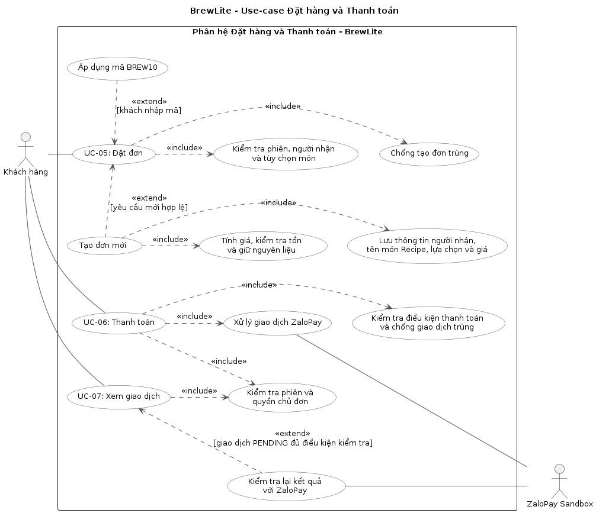

# Task 1.3 Đặc tả use-case trọng tâm

## 1. Bảng đặc tả use-case

<table border="2" cellpadding="8" cellspacing="0" style="border-collapse: collapse; border: 2px solid #000;">
  <tr>
    <th scope="row" style="border: 2px solid #000; padding: 8px;">Use-case name</th>
    <td style="border: 2px solid #000; padding: 8px;">Đặt và thanh toán đơn hàng</td>
  </tr>
  <tr>
    <th scope="row" style="border: 2px solid #000; padding: 8px;">Actor</th>
    <td style="border: 2px solid #000; padding: 8px;">Khách hàng; ZaloPay Sandbox là tác nhân hỗ trợ.</td>
  </tr>
  <tr>
    <th scope="row" style="border: 2px solid #000; padding: 8px;">Description</th>
    <td style="border: 2px solid #000; padding: 8px;">Khách hàng đặt đồ uống từ giỏ, nhập thông tin người nhận tại quầy và thanh toán thử qua ZaloPay Sandbox. Hệ thống kiểm tra món, giá và nguyên liệu; xác nhận kết quả thanh toán để khách theo dõi đơn và nhận món. Phạm vi gồm UC-05, UC-06 và UC-07.</td>
  </tr>
  <tr>
    <th scope="row" style="border: 2px solid #000; padding: 8px;">Trigger</th>
    <td style="border: 2px solid #000; padding: 8px;">Khách chọn tiếp tục đặt đơn từ giỏ, hoặc mở đơn đã tạo để tiếp tục thanh toán.</td>
  </tr>
  <tr>
    <th scope="row" style="border: 2px solid #000; padding: 8px;">Preconditions</th>
    <td style="border: 2px solid #000; padding: 8px;">Khách có món trong giỏ khi tạo đơn mới và có phiên đăng nhập hợp lệ lúc xác nhận. Khi thanh toán đơn đã tạo, khách phải là chủ đơn và đơn còn đủ điều kiện thanh toán; không yêu cầu giỏ còn món.</td>
  </tr>
  <tr>
    <th scope="row" style="border: 2px solid #000; padding: 8px;">Postconditions</th>
    <td style="border: 2px solid #000; padding: 8px;">Thành công: đơn PAID, giao dịch được xác nhận, nguyên liệu giữ được tiêu thụ và điểm được cộng đúng một lần; khách xem lại được đơn của mình. Chưa hoàn tất: đơn có thể đang chờ, thất bại hoặc bị hủy theo kết quả máy chủ. Nếu giao dịch chưa rõ, tiếp tục kiểm tra và giữ nguyên liệu. Lỗi tạo đơn: không để lại đơn hoặc nguyên liệu giữ dở dang. Các lỗi sau khi tạo đơn không xóa bỏ đơn đã tồn tại. Trong mọi trường hợp, không tạo đơn, xử lý kho hoặc cộng điểm trùng; không cho khách truy cập đơn của người khác.</td>
  </tr>
  <tr>
    <th scope="row" style="border: 2px solid #000; padding: 8px;">Normal flow</th>
    <td style="border: 2px solid #000; padding: 8px;">Xem mục 3 — Luồng chính.</td>
  </tr>
  <tr>
    <th scope="row" style="border: 2px solid #000; padding: 8px;">Exceptions</th>
    <td style="border: 2px solid #000; padding: 8px;">Xem các tình huống E-01–E-10 tại mục 4 — Luồng thay thế và ngoại lệ.</td>
  </tr>
  <tr>
    <th scope="row" style="border: 2px solid #000; padding: 8px;">Alternative flows</th>
    <td style="border: 2px solid #000; padding: 8px;">Xem các nhánh A-01–A-06 tại mục 4 — Luồng thay thế và ngoại lệ.</td>
  </tr>
</table>

Đặt đơn và thanh toán là hai bước riêng: tạo đơn thành công chưa có nghĩa đã thanh toán. Khách có thể rời trang sau khi tạo đơn và mở lại đơn để tiếp tục nếu máy chủ còn cho phép.

## 2. Sơ đồ use-case

Tệp nguồn: [use-case-checkout.puml](../diagrams/use-case-checkout.puml).

Sơ đồ thể hiện UC-05 Đặt đơn, UC-06 Thanh toán và UC-07 Xem giao dịch. Quan hệ `include` biểu diễn phần xử lý bắt buộc; `extend` biểu diễn bước chỉ thực hiện khi có điều kiện, như áp dụng BREW10 hoặc kiểm tra lại giao dịch.

## 3. Luồng chính

| Bước | Khách hàng | BrewLite và ZaloPay |
| --- | --- | --- |
| 1 | Chọn tiếp tục đặt đơn từ giỏ | Hiển thị món, size, topping, khẩu vị/ghi chú, số ly và tổng tiền tạm tính |
| 2 | Nhập hoặc kiểm tra thông tin người nhận; nhập mã giảm giá nếu muốn | Khôi phục người nhận từ bản nháp/lượt mua đang lưu của cùng tài khoản; nếu thiếu thì cho nhập bổ sung. Khóa trường khi bản nháp đã có đủ tên người nhận để giữ nguyên yêu cầu khi gửi lại. Kiểm tra dữ liệu và hiển thị tiền giảm/tạm tính |
| 3 | Xác nhận tạo đơn | Kiểm tra đăng nhập, dữ liệu, món và tồn nguyên liệu; tự tính lại giá và khuyến mãi |
| 4 | — | Tạo đơn PENDING, lưu thông tin món/giá/người nhận và giữ nguyên liệu trong cùng giao dịch dữ liệu; hạn ban đầu 15 phút |
| 5 | Xem lại mã đơn, số tiền chính thức và chọn thanh toán | Hiển thị dữ liệu đơn đã lưu; lấy số tiền này để tạo giao dịch ZaloPay Sandbox, không lấy số tiền do trình duyệt tự quyết định |
| 6 | Mở đường dẫn và thực hiện thanh toán trên ZaloPay Sandbox | ZaloPay xử lý giao dịch thử nghiệm |
| 7 | Quay lại trang kết quả của BrewLite | Máy chủ xác minh kết quả qua thông báo hợp lệ từ ZaloPay hoặc truy vấn kết quả; việc khách quay lại trang không tự chứng minh thanh toán thành công. Máy chủ vẫn xử lý kết quả khi khách chưa quay lại |
| 8 | — | Nếu kết quả thành công và nguyên liệu vẫn được giữ, chuyển đơn sang PAID, tiêu thụ kho và cộng điểm theo SRS; xử lý lặp không cập nhật thêm lần nữa. Nếu kho đã được trả, xử lý theo E-07 |
| 9 | Xem kết quả | Hiển thị mã đơn, số tiền, trạng thái, thông tin giao dịch nếu có và hướng dẫn theo dõi để nhận món tại quầy |

Khách chỉ nhận món khi đơn sẵn sàng. Việc Admin pha chế và giao món thuộc UC-10, không thuộc luồng thanh toán này.

## 4. Luồng thay thế và ngoại lệ

| Mã | Xảy ra tại | Tình huống | Cách xử lý và kết quả |
| --- | --- | --- | --- |
| A-01 | Trước bước 2 hoặc tại bước 3 | Chưa đăng nhập hoặc phiên hết hạn | Yêu cầu đăng nhập, giữ giỏ. Khách chưa có tài khoản có thể đăng ký. Sau đăng nhập, khách xem lại và xác nhận đặt đơn; không tự tạo đơn |
| A-02 | Bước 2–3 | Không dùng mã giảm giá | Tiếp tục đặt đơn với tổng tiền không giảm |
| A-03 | Bước 5 | Khách mở lại đơn đã tạo | Lấy giá, món và trạng thái từ đơn đã lưu. Chỉ tiếp tục thanh toán khi máy chủ cho phép; không tạo lại đơn hoặc giữ kho thêm |
| A-04 | Bước 3–4 | Gửi lại yêu cầu tạo đơn | Cùng tài khoản, key và nội dung đã chuẩn hóa thì trả đơn cũ, không giữ thêm kho. Khác nội dung thì từ chối; ngoại lệ bổ sung người nhận cho dữ liệu cũ theo A-06 |
| A-05 | Bước 5–8 | Bấm thanh toán nhiều lần hoặc ZaloPay gửi lại thông báo | Trả lại hoặc cập nhật kết quả giao dịch theo cơ chế chống trùng; không tạo nhiều giao dịch đang hoạt động, không trừ kho/cộng điểm thêm |
| A-06 | Bước 2–4 | Bản nháp/đơn từ phiên bản cũ chưa có người nhận | Bản nháp thiếu người nhận cho nhập bổ sung. Máy chủ chỉ nâng cấp đơn cũ nếu cùng tài khoản/key, món và mã khuyến mãi khớp cách kiểm tra cũ, tên người nhận đang thiếu. Cập nhật người nhận và mã kiểm tra đúng một lần, trả lại đơn cũ; không tạo đơn hoặc giữ thêm kho |
| E-01 | Bước 2–3 | Thông tin người nhận, tùy chọn, số ly hoặc mã giảm giá không hợp lệ | Báo lỗi để khách sửa; không tạo đơn hoặc giữ kho |
| E-02 | Bước 3–4 | Món ngừng bán, thiếu nguyên liệu hoặc lỗi khi lưu đơn | Báo lỗi, giữ thông tin giỏ để khách điều chỉnh; hủy các thay đổi dở dang trong thao tác tạo đơn |
| E-03 | Bước 4–5 | Giá chính thức khác giá tạm tính | Hiển thị rõ số tiền chính thức để khách xem lại trước khi xác nhận thanh toán; không tự thanh toán |
| E-04 | Bước 5–8 | ZaloPay từ chối rõ ràng | Hiển thị kết quả máy chủ. Nếu máy chủ xác nhận thanh toán thất bại, cập nhật trạng thái và trả nguyên liệu giữ đúng một lần. Chỉ thử lại nếu máy chủ cho phép; lỗi tạo giao dịch không mặc nhiên làm đơn thành PAYMENT_FAILED |
| E-05 | Bước 5–8 | Mất mạng, timeout hoặc chưa rõ kết quả | Hiển thị “Đang kiểm tra kết quả”, cho kiểm tra lại. Không tự báo thất bại, tạo giao dịch khác hoặc giải phóng kho khi giao dịch cũ chưa rõ |
| E-06 | Bước 5–8 | Đồng hồ hết hạn | Giao diện lấy lại trạng thái, không tự hủy đơn hay trả kho. Nếu máy chủ xác định đơn hết hạn, chưa thanh toán và không còn giao dịch chưa rõ, máy chủ hủy đơn/trả kho đúng một lần; nếu còn giao dịch chưa rõ, tiếp tục giữ nguyên liệu và đối soát |
| E-07 | Bước 8 | Thành công được xác nhận sau khi nguyên liệu giữ đã được trả lại | Chuyển giao dịch sang cần đối soát; không tự chuyển đơn thành đã thanh toán bình thường hoặc trừ lại kho |
| E-08 | Bước 5–9 | Truy cập đơn người khác hoặc đơn không tồn tại | Từ chối yêu cầu, không tiết lộ dữ liệu đơn/giao dịch và không thay đổi dữ liệu |
| E-09 | Bước 7–9 | Tải lại trang kết quả | Lấy trạng thái mới từ máy chủ; không tự tạo đơn hoặc thanh toán lại |
| E-10 | Bước 7–8 | Thông báo ZaloPay sai chữ ký hoặc sai số tiền | Không xác nhận thanh toán thành công, không trừ kho/cộng điểm; phản hồi hoặc ghi nhận lỗi theo hợp đồng tích hợp |

Nếu tạo đơn bị mất phản hồi, không mặc định thao tác thất bại: gửi lại cùng mã chống trùng để xác định đơn đã được tạo hay chưa. Tương tự, lỗi kết nối thanh toán không đồng nghĩa tiền chưa được xử lý.

## 5. Liên kết yêu cầu và kiểm tra dự kiến

| Nội dung cần kiểm tra | Yêu cầu SRS |
| --- | --- |
| Món, tùy chọn và giỏ được giữ đúng khi sang trang đặt đơn | FR-03, FR-04, FR-10 |
| Chưa đăng nhập/hết phiên không tạo được đơn | FR-06, FR-07; NFR-03 |
| Người nhận và BREW10; giá chính thức do máy chủ tính | FR-12, FR-13, FR-14 |
| Tạo đơn, giữ kho và lỗi không để lại dữ liệu dở dang | FR-14, FR-15; NFR-04 |
| Chủ đơn thanh toán qua ZaloPay Sandbox | FR-16; NFR-03 |
| Gửi lặp/đồng thời và callback lặp không ghi kép | FR-15, FR-17, FR-21; NFR-04 |
| Kết quả thất bại, chưa rõ hoặc cần đối soát hiển thị đúng | FR-17, FR-18, FR-20; NFR-05 |
| Hết hạn không tự kết luận khi giao dịch chưa rõ | FR-19, FR-20 |
| Xem lại kết quả/đơn của mình; tải lại không thanh toán thêm | FR-18, FR-22; NFR-03 |
| Điểm cộng đúng một lần khi xác nhận thanh toán | FR-21 |

Các liên kết trên là cơ sở xây dựng ca kiểm thử cho luồng đặt và thanh toán đơn hàng.

Chi tiết API kế thừa và các lưu ý kỹ thuật: [Đối chiếu repo cũ — API checkout](legacy-repo-review.md#api-checkout-kế-thừa-và-phần-cần-hoàn-thiện).
